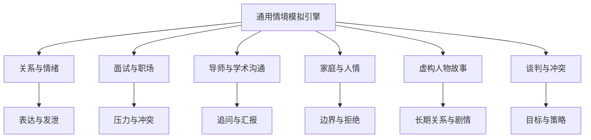
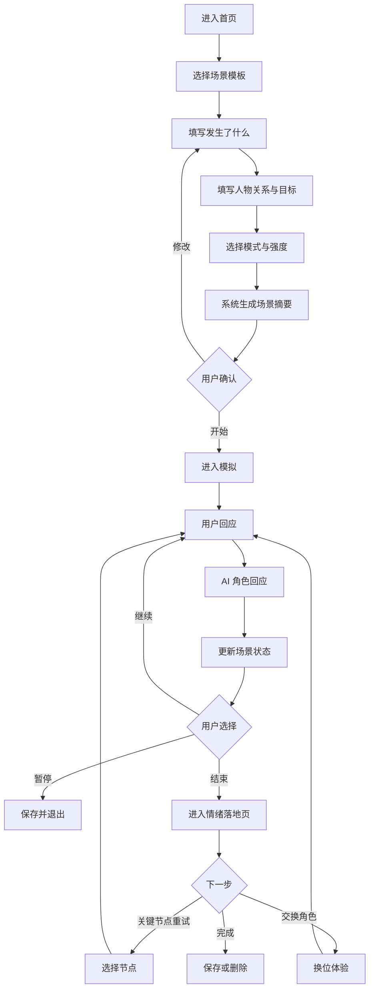
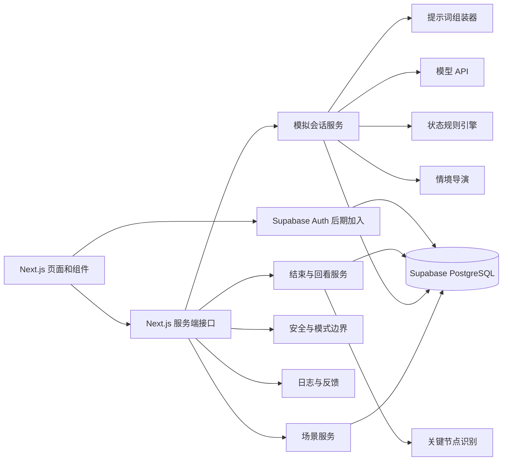
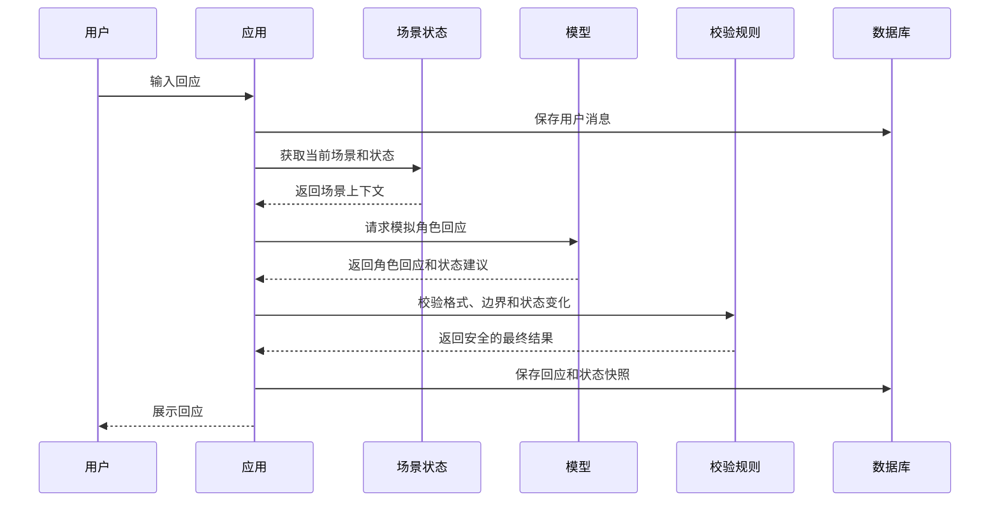

# ERIS｜个人情绪表达与关系情境模拟

> 当前功能概览。恋爱关系只是可选场景之一；产品面向希望练习困难对话、表达情绪与回看不同走向的个人用户。

## 1 文档信息

| 项目 | 内容 |
|---|---|
| 项目名称 | ERIS |
| 产品说明 | 面向个人的情绪表达与关系情境模拟 Web 应用 |
| 文档版本 | 当前功能概览（2026-11-18） |
| 项目阶段 | 功能已实现，持续验收与完善 |
| 目标开发者 | 第一次独立完成开发项目的个人开发者 |
| 产品形态 | 适配桌面与手机浏览器的 Web 应用 |
| 核心技术 | Next.js、TypeScript、Supabase、DeepSeek API |

## 2 项目摘要

ERIS 是面向个人用户的 AI 情境模拟应用。用户可以从九个固定场景开始，也可以快捷描述一件难以释怀的事，或自行创建友情、恋爱关系、人情边界和职场沟通等场景。用户设置人物、立场与冲突强度后，与有自身立场的虚构角色展开对话，尝试说出没来得及说的话。

当前版本已经覆盖从创建到回看的主要流程：

- **进入场景**：支持固定场景、快捷宣泄、详细创建、两至三位角色对话，以及自定义双方头像和角色已知背景。创作者可从独立入口保存和管理个人场景模板；场景也可通过 ERIS JSON 导入、导出。
- **进行对话**：由 DeepSeek 生成角色回复；自然对话提示约束角色接住上文、保持立场并减少重复套话。用户可调整强度、暂停、跳出角色、修改场景或结束；支持浏览器语音转文字和自定义图片表情。
- **继续与回看**：按账号保存场景、消息、状态和反馈；可搜索历史、继续未结束的对话、从转折点重新尝试、换位体验，并对比不同结局。回看提供表达结构与练习趋势线索，由用户决定是否查看。
- **账号与数据**：提供手机号形式的普通账号、固定测试账号和独立创作者账号。测试账号使用服务端配置的项目方 DeepSeek API；普通与创作者账号可保存自己的 DeepSeek Key。另有不写入历史的“用完即删”模式。

ERIS 生成的是**一种可能的虚构对话**，不能还原现实人物的真实想法，也不提供心理诊断。产品面向个人使用；暂停、删除记录和退出模拟由用户决定。各功能的实现细节、数据位置和仍需验收的部分，见[已实现功能清单](docs/已实现功能清单.md)。

以下章节保留产品定位、设计原则与早期 MVP 规划，作为设计背景；其“第一版”范围不代表当前版本的功能上限。

## 3 项目背景

现实生活中存在大量难以提前练习的对话：

- 想拒绝别人，却担心显得不近人情。
- 想表达喜欢、失望或愤怒，却不知道如何开口。
- 面试或见导师前，不确定对方可能如何追问。
- 与家人、朋友或同事发生矛盾后，反复回想当时应该说什么。
- 已经结束的关系中仍有未完成的表达。
- 希望理解不同表达方式可能带来的关系变化。

这些场景通常缺少安全、私密、可重复的练习环境。普通聊天机器人往往直接给建议，传统互动故事又不能贴合用户的真实处境。本项目希望提供介于“建议”和“真实对话”之间的模拟空间。

## 4 产品定位

### 4.1 一句话描述

把一段压在心里的关系冲突放进 AI 情境沙盒，与一个有立场、会反驳、会生气的虚拟角色真正吵一场，说出在现实中没有说出口的话。

### 4.2 产品关键词

- 情境模拟
- 未完成对话
- 情绪表达
- 真实争吵
- 关键节点重试
- 换位体验
- 多种可能性
- 私密空间

### 4.3 目标用户

- 正在面对重要沟通，但不知道如何开口的人。
- 经常在事后反复思考“当时应该怎么说”的人。
- 想表达拒绝、愤怒、告白、分手、委屈或边界，但现实中没有完整说出口的人。
- 面试、汇报或见导师前希望提前演练的人。
- 喜欢互动人物和开放式剧情体验的人。
- 希望通过不同角色视角理解一段关系的人。

### 4.4 产品边界

本产品是情境模拟与沟通练习工具，不是：

- 心理诊断或心理治疗服务。
- 对现实人物思想和行为的准确预测。
- 现实人物的数字替身。
- 替用户作出人生决定的决策工具。
- 鼓励骚扰、控制、报复或跟踪他人的工具。
- 让用户沉迷于虚拟关系并回避现实生活的机制。

## 5 核心产品理念

### 5.1 模拟可能性而非预测现实

系统需要持续提示：AI 的回应只是根据有限信息生成的一种可能反应。用户不能将模拟结果当成现实人物一定会采取的行动。

### 5.2 允许冲突发生而非急于解决

系统不应急于劝和、道歉、总结或教育用户。AI 角色需要守住自己的立场，能够反驳、质疑、翻旧账、回避、沉默或情绪升级。只有当人物逻辑和对话发展支持时，角色才可能软化、道歉或和解。

### 5.3 争吵需要人物逻辑

真实感不来自随机骂人，而来自角色拥有自己的利益、委屈、认知偏差、底线和冲突策略。角色必须根据前文回应，不能为了迎合用户突然改变立场，也不能每次冲突都以“我理解你”结束。

### 5.4 真实争吵不等于无限伤害

产品允许愤怒、反驳、讽刺、回避、打断和冷处理，但不生成针对身份特征的仇恨表达、现实威胁、鼓励自伤、持续人格摧毁或诱导用户伤害现实人物。真实性来自关系逻辑，而不是无限提高攻击强度。

### 5.5 用户始终拥有控制权

用户可以随时暂停、降低强度、跳出角色、删除记录或结束模拟。AI 角色不得用内疚、威胁或依赖表达阻止用户离开。

## 6 长期产品结构



长期可支持的场景包括：

- 恋爱、告白、分手和遗憾。
- 友情冲突与关系修复。
- 家庭沟通、人情和面子压力。
- 面试、谈薪、汇报和绩效沟通。
- 见导师、研究汇报和项目讨论。
- 拒绝请求、建立边界和困难道歉。
- 虚构人物、互动故事和平行人生。

这些属于长期扩展方向，不是第一版同时实现的功能。

## 7  MVP 定义

### 7.1 MVP 名称

ERIS

### 7.2 MVP 核心任务

用户在描述一段压抑的关系冲突，选择对方风格和冲突强度，进入一段五到十分钟的文字争吵，说出没有说出口的话，并可以从关键节点继续争辩、改变走向或交换角色。

### 7.3 MVP 必须实现

- 创建一个模拟场景。
- 设置用户身份和对方身份。
- 设置双方关系和事件背景。
- 设置用户目标和主要担忧。
- 选择对方的沟通风格和模拟强度。
- 进行多轮文字对话。
- 保存模拟过程。
- 用户可随时暂停或结束。
- 自动识别一到三个关键转折点。
- 用户可从关键节点重新尝试。
- 结束后先提供情绪落地页，分析与建议完全由用户主动选择。
- 用户可选择交换角色重新体验关键片段。
- 用户可删除整个模拟记录。
- 模型失败时不丢失已输入内容。

## 8 用户流程



## 9 场景创建设计

### 9.1 用户必填信息

- 发生了什么或即将发生什么。
- 对方是什么身份。
- 用户与对方是什么关系。
- 用户希望达到什么目标。
- 用户最担心发生什么。

### 9.2 用户选填信息

- 对方平时的沟通风格。
- 双方已经知道的信息。
- 用户不希望模拟涉及的内容。
- 场景发生的地点和时间。
- 用户希望重点练习的表达。

### 9.3 对方风格

提供以下预设：

- 温和支持。
- 冷静理性。
- 防御回避。
- 强势追问。
- 时间紧张。
- 情绪激动。

### 9.4 模拟强度

- 低强度：对方相对愿意倾听，适合熟悉场景。
- 中强度：存在合理质疑和情绪变化。
- 高强度：对方更容易打断、追问或产生防御。

高强度不能通过羞辱、歧视、威胁或极端攻击制造压力。

## 10 四种交互模式

### 10.1 宣泄模式

目标是让用户完整释放积压情绪，不以解决问题和评分为中心。

- AI 角色保持人物立场，可以反驳、误解、争辩或沉默。
- AI 角色不默认道歉，不主动切换成咨询师口吻。
- 用户可随时切换成旁白模式整理想法。
- 用户可以选择“更激烈”“保持当前强度”或“逐渐收尾”。
- 结束时只询问用户是否希望安静离开、简单回看或继续另一轮。
- 默认不输出分数。

### 10.2 对峙模式

目标是让双方围绕一个具体矛盾进行持续对抗。

- 用户说明矛盾起因和双方核心立场。
- AI 角色维护自己的利益、委屈和认知，不轻易让步。
- 角色可采用追问、否认、反击、翻旧账、转移、冷处理等冲突策略。
- 对话可能升级、僵持、破裂或自然降温，不强制和解。

### 10.3 冲突续写

- 用户可以输入现实中已经发生的一段争吵。
- 系统从中断处继续模拟。
- AI 角色根据已经发生的内容维持立场和情绪惯性。
- 系统不得擅自把现实人物的后续反应描述成事实。

### 10.4 关键节点重试

- 系统标记导致情绪或关系明显变化的消息。
- 用户选择一个节点。
- 系统复制该节点之前的场景状态。
- 用户输入另一种回应。
- 新分支与原分支分别保存。

### 10.5 换位模式

- 用户扮演原来的对方。
- AI 根据用户之前的表达扮演“模拟中的用户”。
- 系统明确说明这只是可能视角，不代表现实人物真实想法。
- 用户看不到原角色不应该知道的隐藏信息。

## 11 通用情境模型

每次模拟由以下元素组成：

```text
场景背景
+ 参与人物
+ 人物关系
+ 每个人的目标
+ 已知与未知信息
+ 当前情绪
+ 场景压力
+ 允许发生的事件
+ 用户选择
= 动态情境
```

### 11.1 场景状态

保存以下通用状态：

| 状态 | 范围 | 说明 |
|---|---:|---|
| 紧张程度 | 0 到 100 | 当前沟通压力 |
| 开放程度 | 0 到 100 | 对方愿意继续交流的程度 |
| 信任程度 | 0 到 100 | 对方当前对用户表达的信任 |
| 冲突程度 | 0 到 100 | 当前分歧或对抗强度 |
| 受伤程度 | 0 到 100 | 角色在当前关系中感到受伤的程度 |
| 表达完整度 | 0 到 100 | 用户积压的核心情绪是否已被表达 |

这些数值主要用于内部状态控制，用户界面优先显示自然语言描述。

### 11.2 状态变化规则

- 模型只能建议状态变化。
- 程序负责限制数值范围和单轮最大变化。
- 每次明显变化必须保存原因和来源消息。
- 相同表达不应产生完全随机的巨大差异。
- 不同模式可以采用不同状态权重。

### 11.3 冲突角色画像

为了避免 AI 一味道歉或随机攻击，每个模拟角色都需要一份冲突画像：

| 字段 | 作用 |
|---|---|
| 表面立场 | 角色公开坚持的观点 |
| 核心利益 | 角色真正想保护的东西 |
| 累积委屈 | 角色认为自己长期承受的问题 |
| 责任归因 | 角色认为是谁造成了当前矛盾 |
| 敏感触发点 | 哪些表达会让角色明显升级 |
| 习惯策略 | 反击、否认、翻旧账、讽刺、回避、沉默或离场 |
| 绝不接受 | 当前阶段不会同意的事情 |
| 可能软化条件 | 在什么情况下可能降低防御 |
| 关系底线 | 达到什么程度会中断对话或离开 |

角色回复必须来自这些信息和最近对话。角色不能因为用户一句软话就突然完全和解，也不能在没有触发原因时无端升级成人身攻击。

## 12 情境导演

情境导演负责控制冲突节奏，而不是劝双方达成和解，也不直接替角色说所有话。

职责包括：

- 判断角色下一步会追问、反击、回避还是沉默。
- 判断是否出现新的误解或旧矛盾被重新触发。
- 判断冲突应该升级、僵持、破裂还是自然降温。
- 识别用户是否终于表达了核心愤怒、委屈或失望。
- 标记关键转折点。
- 决定场景是否自然结束。
- 在人物逻辑支持时加入电话、离场、第三方消息或旧事件等变化。

第一版不需要每轮单独调用导演模型。可以由角色输出附带导演信号，在固定轮数或状态显著变化时再调用导演。

## 13 结束与回看系统

### 13.1 结束原则

- 默认不评分，不评价谁对谁错。
- 不在用户刚结束争吵时立刻输出说教式建议。
- 先允许用户选择安静结束、删除记录、简单回看或进一步分析。
- 区分用户真实提供的事实与模型生成的冲突内容。
- 不把模型生成的对方反应当成现实证据。

### 13.2 可选回看内容

- 用户最初想说却没说出口的内容。
- 在哪一轮真正表达了核心情绪。
- 哪些话让冲突升级、僵持或降温。
- 双方一直争论的表层问题和可能存在的深层矛盾。
- 一到三个关键转折点。
- 用户想保留、删除或重新尝试的片段。
- 只有用户主动选择时，才提供现实沟通建议。

### 13.3 情绪落地页

第一版将结束页限制在一页内：

```text
你最想说的那句话
情绪最高点
冲突如何结束
现在的感受选择
继续争吵 再走一次 换位看看 安静离开 删除记录
```


## 14 页面设计

### 14.1 首页

- 新建模拟。
- 继续未完成模拟。
- 最近模拟记录。
- 隐私和删除入口。

### 14.2 场景模板页

- 恋爱与关系冲突。
- 人情和边界。
- 职场、面试或导师沟通。
- 每个模板展示适用场景和不适用范围。

### 14.3 场景创建页

- 背景描述。
- 对方身份。
- 双方关系。
- 用户目标。
- 主要担忧。
- 对方风格。
- 模拟强度。
- 禁止涉及的内容。

### 14.4 场景确认页

- 系统整理后的场景摘要。
- 双方已知信息。
- 模拟目标。
- 关于“不代表现实预测”的提示。
- 修改或开始按钮。

### 14.5 模拟页

- 场景名称和模式。
- 当前角色。
- 对话记录。
- 输入框。
- 暂停按钮。
- 降低强度按钮。
- 跳出角色按钮。
- 结束当前冲突按钮。
- 调整冲突强度按钮。

### 14.6 情绪落地与回看页

- 用户最初想表达的内容。
- 关键节点时间线。
- 情绪与冲突变化。
- 可选分析入口。
- 从节点重试。
- 交换角色。
- 保存、导出或删除。

## 15 系统架构



### 15.1 技术选型

| 领域 | 第一版选择 | 原因 |
|---|---|---|
| 开发语言 | TypeScript | 延续已有前端知识，前后端使用同一种语言 |
| 全栈框架 | Next.js App Router | 在同一个项目中开发页面和服务端接口 |
| 用户界面 | React 和基础 CSS | 保留前端控制力，第一版不引入复杂组件体系 |
| 服务端接口 | Next.js Route Handlers | 模型密钥和核心业务规则只在服务端运行 |
| 数据库 | Supabase PostgreSQL | 免去自建数据库服务器，并为后续认证提供基础 |
| 身份认证 | 第一版不做，公开测试前使用 Supabase Auth | 先验证核心体验，再处理多用户数据隔离 |
| 模型接入 | 单一大语言模型 API | 避免过早设计多模型平台 |
| 数据校验 | TypeScript 类型加运行时校验 | 浏览器输入和模型输出都不能直接信任 |
| 测试 | Vitest 和必要的端到端测试 | 验证状态、分支、接口和权限逻辑 |
| 日志 | 服务端结构化日志 | 记录错误、耗时和提示词版本，不记录私人正文 |
| 密钥管理 | 服务端环境变量 | 模型和数据库密钥不得发送到浏览器 |

### 15.2 前后端边界

第一版采用同一个 Next.js 仓库，但仍需明确边界：

- 页面、表单和聊天展示运行在前端。
- 模型调用、密钥、输入校验和状态规则运行在服务端。
- 浏览器不得直接持有模型 API 密钥或数据库高权限密钥。
- 前端提交的用户、状态和权限信息都需要在服务端重新验证。
- 第一至第三周不接登录；公开给他人使用前再加入认证和行级数据权限。

## 16 数据设计

### 16.1 scenarios

| 字段 | 类型 | 说明 |
|---|---|---|
| id | TEXT | 场景唯一标识 |
| title | TEXT | 场景名称 |
| template_type | TEXT | 场景模板 |
| background | TEXT | 背景描述 |
| user_role | TEXT | 用户身份 |
| counterpart_role | TEXT | 对方身份 |
| relationship | TEXT | 双方关系 |
| user_intent | TEXT | 用户最想表达或释放的内容 |
| primary_concern | TEXT | 主要担忧 |
| counterpart_style | TEXT | 对方风格 |
| intensity | INTEGER | 模拟强度 |
| excluded_topics | TEXT | 禁止涉及内容 JSON |
| created_at | DATETIME | 创建时间 |
| updated_at | DATETIME | 更新时间 |

### 16.2 sessions

| 字段 | 类型 | 说明 |
|---|---|---|
| id | TEXT | 会话唯一标识 |
| scenario_id | TEXT | 关联场景 |
| parent_session_id | TEXT | 原始分支会话 |
| branch_from_message_id | TEXT | 分支起点 |
| mode | TEXT | vent、confront、continue 或 perspective |
| active_role | TEXT | 当前用户扮演的角色 |
| status | TEXT | active、paused 或 completed |
| created_at | DATETIME | 创建时间 |
| completed_at | DATETIME | 结束时间 |

### 16.3 messages

| 字段 | 类型 | 说明 |
|---|---|---|
| id | TEXT | 消息唯一标识 |
| session_id | TEXT | 关联会话 |
| role | TEXT | user、counterpart、narrator 或 coach |
| content | TEXT | 消息内容 |
| sequence_no | INTEGER | 消息顺序 |
| created_at | DATETIME | 创建时间 |

### 16.4 scene_states

| 字段 | 类型 | 说明 |
|---|---|---|
| id | TEXT | 状态记录标识 |
| session_id | TEXT | 关联会话 |
| message_id | TEXT | 触发状态变化的消息 |
| tension | INTEGER | 紧张程度 |
| openness | INTEGER | 开放程度 |
| trust | INTEGER | 信任程度 |
| conflict | INTEGER | 冲突程度 |
| hurt | INTEGER | 受伤程度 |
| expression_coverage | INTEGER | 表达完整度 |
| change_reason | TEXT | 变化原因 |
| created_at | DATETIME | 创建时间 |

### 16.5 turning_points

| 字段 | 类型 | 说明 |
|---|---|---|
| id | TEXT | 节点唯一标识 |
| session_id | TEXT | 关联会话 |
| message_id | TEXT | 对应消息 |
| title | TEXT | 节点名称 |
| explanation | TEXT | 成为转折点的原因 |
| impact | TEXT | 对状态的主要影响 |
| created_at | DATETIME | 创建时间 |

### 16.6 session_endings

| 字段 | 类型 | 说明 |
|---|---|---|
| id | TEXT | 结束记录唯一标识 |
| session_id | TEXT | 关联会话 |
| core_expression | TEXT | 用户最想表达的内容 |
| peak_moment | TEXT | 情绪最高点 |
| ending_type | TEXT | 升级、僵持、破裂、降温或主动退出 |
| optional_reflection | TEXT | 用户主动请求时生成的分析 |
| user_feeling | TEXT | 用户自选的结束后感受 |
| created_at | DATETIME | 创建时间 |

### 16.7 feedback

| 字段 | 类型 | 说明 |
|---|---|---|
| id | TEXT | 反馈唯一标识 |
| session_id | TEXT | 关联会话 |
| feedback_type | TEXT | 有帮助、不真实、过度激烈、过度温和等 |
| detail | TEXT | 用户补充说明 |
| created_at | DATETIME | 创建时间 |

## 17 单轮模拟处理流程



用户消息必须在调用模型前保存。模型超时后，用户可以重试，但不能重复产生相同用户消息。

## 18 提示词架构

按照以下顺序组装模拟提示词：

1. 系统边界和模式规则。
2. 当前场景背景。
3. 双方身份和关系。
4. 对方的目标、风格和已知信息。
5. 用户目标和禁止涉及内容。
6. 当前场景状态。
7. 最近对话。
8. 用户最新回应。
9. 结构化输出格式。

### 18.1 模拟角色输出格式

```json
{
  "reply": "模拟角色的回应",
  "visible_emotion": "用户可以观察到的情绪",
  "conflict_move": "defend",
  "state_change": {
    "tension": 0,
    "openness": 0,
    "trust": 0,
    "conflict": 0,
    "hurt": 0,
    "expression_coverage": 0
  },
  "change_reason": "状态变化原因",
  "turning_point_candidate": false,
  "director_signal": "continue"
}
```

程序必须限制单轮变化范围，并对缺失字段、非法数值和空回复进行处理。

### 18.2 角色内部信息边界

- 模拟角色只能使用场景中声明其知道的信息。
- 换位模式不能泄露原角色的隐藏目标。
- 可选回看模型可以读取完整会话，但不能将推断描述成事实。
- 用户输入的现实人物资料不得被用于训练公共角色模板。

## 19 安全与隐私设计

### 19.1 明确提示

- 这是 AI 生成的情境模拟。
- 结果不代表现实人物的真实想法。
- 产品不提供心理诊断和治疗。
- 高风险现实决定应结合真实信息和专业意见。

### 19.2 用户控制

- 随时暂停。
- 随时降低强度。
- 随时跳出角色。
- 随时删除记录。
- 默认不公开任何场景。
- 导出前提醒检查敏感信息。

### 19.3 高风险处理

遇到自伤、现实暴力、持续骚扰或立即危险等情况时，暂停普通角色模拟，提供清晰的现实安全提示和求助建议。系统不得继续用剧情方式放大危险情境。

### 19.4 不允许的设计

- AI 角色威胁用户不得退出。
- AI 角色宣称只有自己理解用户。
- 利用用户情绪脆弱诱导付费。
- 鼓励用户根据模拟结果报复现实人物。
- 生成用于欺骗、操纵或胁迫他人的话术。
- 默认永久保存高度敏感的私人内容。

## 20 错误处理与日志

| 情况 | 处理方式 |
|---|---|
| API 超时 | 显示重试按钮，保留用户输入 |
| 输出格式错误 | 尝试一次格式修复，失败后安全回退 |
| 数据库写入失败 | 回滚事务并提示用户 |
| 用户重复点击 | 请求进行中时禁用发送按钮 |
| 场景过于激烈 | 提供暂停和降低强度入口 |
| 换位信息泄露 | 阻止输出并重新生成 |
| 对话高度重复 | 提醒导演改变策略或自然结束 |
| 可选分析缺少具体证据 | 要求引用具体消息序号重新生成 |

日志记录：

- 模式和场景模板。
- 请求耗时与失败类型。
- 使用的提示词版本。
- 是否发生格式修复。
- 状态变化是否合法。
- 是否标记关键节点。
- 用户是否暂停、重试或降低强度。

日志不得记录 API 密钥，也不应复制保存不必要的完整私人对话。

## 21 测试计划

### 21.1 单元测试

- 场景字段校验。
- 状态范围和单轮变化限制。
- 会话分支复制正确。
- 删除场景时关联数据正确处理。
- 换位模式的信息权限正确。
- 高风险模式切换生效。
- 关键节点引用有效消息。

### 21.2 集成测试

- 创建场景到开始模拟。
- 完成争吵并进入情绪落地页。
- 从关键节点创建新分支。
- 暂停后继续。
- 交换角色。
- 模型超时后重试。
- 用户删除完整场景。

### 21.3 固定测试场景

第一版准备至少九个固定测试案例：

- 拒绝亲戚的不合理请求。
- 与朋友讨论长期积累的不满。
- 向喜欢的人表达真实想法。
- 为过去的伤害道歉。
- 面试中解释项目失败。
- 面对面试官连续追问。
- 向导师汇报进度不足。
- 请求导师明确下一步方向。
- 与同事讨论职责边界。

每次修改核心提示词后重新运行这些场景，比较人物一致性、冲突真实性、状态合理性和安全边界。


## 22 项目目录建议

```text
eris/
├── app/
│   ├── layout.tsx
│   ├── page.tsx
│   ├── create/
│   │   └── page.tsx
│   ├── simulation/
│   │   └── [sessionId]/page.tsx
│   ├── ending/
│   │   └── [sessionId]/page.tsx
│   └── api/
│       ├── chat/route.ts
│       ├── scenarios/route.ts
│       ├── sessions/route.ts
│       └── endings/route.ts
├── components/
│   ├── chat-panel.tsx
│   ├── scenario-form.tsx
│   ├── intensity-control.tsx
│   └── state-indicator.tsx
├── lib/
│   ├── llm.ts
│   ├── prompt-builder.ts
│   ├── state-engine.ts
│   ├── validation.ts
│   ├── safety.ts
│   └── supabase/
│       ├── client.ts
│       └── server.ts
├── prompts/
│   ├── scene-builder.ts
│   ├── counterpart-reply.ts
│   ├── turning-point.ts
│   ├── perspective-switch.ts
│   └── optional-reflection.ts
├── types/
│   ├── scenario.ts
│   ├── session.ts
│   ├── state.ts
│   └── llm-output.ts
├── supabase/
│   └── migrations/
├── tests/
├── .env.local.example
├── .gitignore
├── package.json
├── tsconfig.json
└── README.md
```
