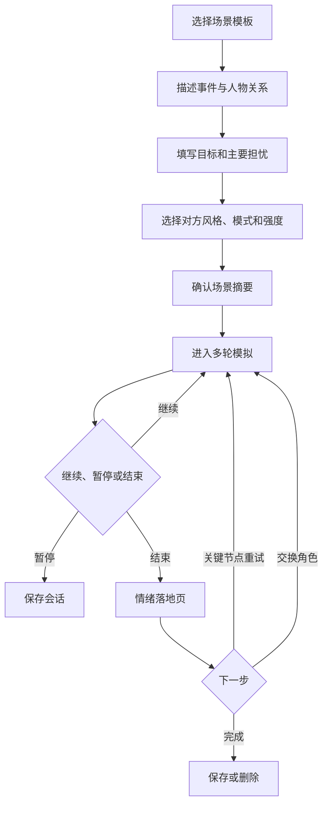

# ERIS

> 把一段压在心里的关系冲突放进 AI 情境沙盒，与一个有立场、会反驳、会生气的虚拟角色真正谈一次，说出在现实中没有说出口的话。

ERIS 是一款面向情绪表达、关系冲突和困难沟通的 AI 情境模拟产品。它不会声称能够还原现实人物的真实想法，而是根据用户提供的背景，生成一种具有现实逻辑的虚构冲突，让用户在私密、可暂停、可重试的空间里表达情绪并探索不同走向。

## 项目状态

项目目前处于 **MVP 第 1 周：对话闭环验证**。

当前仓库中的可运行原型使用 Python、Streamlit 和 OpenAI Responses API，已经实现：

- 单页文字对话界面。
- 一个临时结构化虚拟角色。
- 最近 12 条消息上下文。
- 服务异常、超时、限流和连接失败提示。
- 环境变量与密钥隔离。

项目书定义的正式技术栈是 **Next.js、TypeScript、Supabase 和单一大语言模型 API**。当前 Streamlit 原型用于快速验证模型对话体验，后续将迁移到正式技术栈。数据库、状态引擎、关键节点、换位模式和用户系统尚未实现。

## 产品原则

- **模拟可能性，不预测现实**：模型生成的是一种可能反应，不代表现实人物会这样想或行动。
- **允许冲突发生**：角色不会默认道歉、讲道理或急于和解，而会依据自身利益、委屈和立场回应。
- **冲突来自人物逻辑**：真实感来自目标、误解、触发点和底线，不来自随机辱骂。
- **真实不等于无限伤害**：不生成仇恨表达、现实威胁、自伤鼓励或持续人格摧毁。
- **用户始终拥有控制权**：用户可以随时暂停、降低强度、跳出角色、结束模拟或删除记录。

## MVP 场景

第一版聚焦三类场景：

1. 恋爱与关系冲突。
2. 人情、面子和边界表达。
3. 职场、面试或导师沟通。

计划支持的核心模式：

- **宣泄模式**：完整表达积压情绪，不以评分和解决问题为中心。
- **对峙模式**：围绕具体矛盾持续交锋，允许升级、僵持、破裂或降温。
- **冲突续写**：从现实中断的争吵处继续，但不把生成结果描述成事实。
- **关键节点重试**：从转折点换一种回应，并保留不同分支。
- **简化换位模式**：交换角色体验可能视角，同时遵守双方信息边界。

## 目标用户流程



## 目标技术架构

| 领域 | MVP 选择 |
|---|---|
| 全栈框架 | Next.js App Router |
| 开发语言 | TypeScript |
| 界面 | React 与基础 CSS |
| 服务端接口 | Next.js Route Handlers |
| 数据库 | Supabase PostgreSQL |
| 身份认证 | 公开测试前接入 Supabase Auth |
| 模型接入 | 单一大语言模型 API |
| 数据校验 | TypeScript 类型与运行时校验 |
| 测试 | Vitest 与必要的端到端测试 |
| 密钥管理 | 仅服务端环境变量 |

浏览器不得持有模型 API 密钥或数据库高权限密钥。模型输出、前端状态和权限信息都必须在服务端重新校验。

## 当前原型的本地启动

当前分支仍是 Streamlit 验证原型，需要 Python 3.11 或更高版本。

```bash
python3.12 -m venv .venv
source .venv/bin/activate
pip install -e .
cp .env.example .env
```

编辑 `.env`：

```dotenv
OPENAI_API_KEY=your_api_key_here
OPENAI_MODEL=gpt-6-astra
```

启动：

```bash
streamlit run app.py
```

浏览器通常会打开 `http://localhost:8501`。

## 八周开发路线

| 周次 | 目标 | 交付结果 |
|---:|---|---|
| 1 | 固定冲突场景与服务端模型调用 | 与有明确立场的固定角色连续对话，密钥不进入浏览器 |
| 2 | 冲突角色画像与结构化输出 | 角色拥有利益、委屈、触发点和冲突策略，输出可校验 |
| 3 | 用户场景创建 | 用户可创建自己的关系冲突并开始模拟 |
| 4 | Supabase 持久化 | 刷新后恢复会话，并能完整删除场景数据 |
| 5 | 冲突状态引擎 | 管理紧张、开放、信任、冲突、受伤和表达完整度 |
| 6 | 情绪落地与分支重试 | 标记关键节点并从节点创建新走向 |
| 7 | 用户隔离、安全与隐私 | 身份认证、行级权限、限流和日志脱敏 |
| 8 | 评测、发布与用户验证 | 完整闭环、固定测试集、部署和小范围用户测试 |

## MVP 完成标准

- 用户能在约一分钟内创建场景。
- 用户能完成至少十轮模拟对话。
- 三类模板的对话风格存在明显差异。
- 角色根据用户回应改变反应，而不是重复固定问题或机械道歉。
- 系统能识别一至三个关键转折点。
- 用户能从关键节点重新开始并保留不同走向。
- 换位时双方的信息边界基本正确。
- 关闭应用后可以继续未完成的模拟。
- 用户可以永久删除自己的记录。
- 另一位开发者能根据 README 独立启动项目。

## 安全与隐私

ERIS 是情境模拟与沟通练习工具，不是心理诊断、心理治疗、现实人物预测或决策工具。

- 默认不公开任何模拟内容。
- 不鼓励骚扰、控制、跟踪或报复现实人物。
- 遇到自伤、现实暴力或立即危险时停止普通角色模拟，转为现实安全提示。
- 日志不得记录 API 密钥，也不应复制保存不必要的完整私人对话。
- AI 角色不得以威胁、内疚或依赖表达阻止用户退出。

## 当前限制

- 当前代码是 Streamlit 技术验证版，与项目书的 Next.js 正式架构尚未统一。
- 消息只保存在浏览器会话内，刷新后会丢失。
- 尚未实现自定义场景、冲突强度、状态变化、关键节点或换位模式。
- 尚未完成十轮固定场景人工评测。

## 开发纪律

1. 同一时间只实现一个用户闭环。
2. 一个功能对应一个清晰的 Git 提交。
3. 新需求先更新项目书，再决定是否开发。
4. 模型输出必须经过程序校验。
5. 密钥和私人数据不得提交到仓库。
6. 先完成文字 MVP，再评估语音、移动端和商业化。

## 免责声明

所有模拟角色和回应均由 AI 生成，仅用于情境探索与表达练习，不代表现实人物的真实想法、意图或未来行为。
